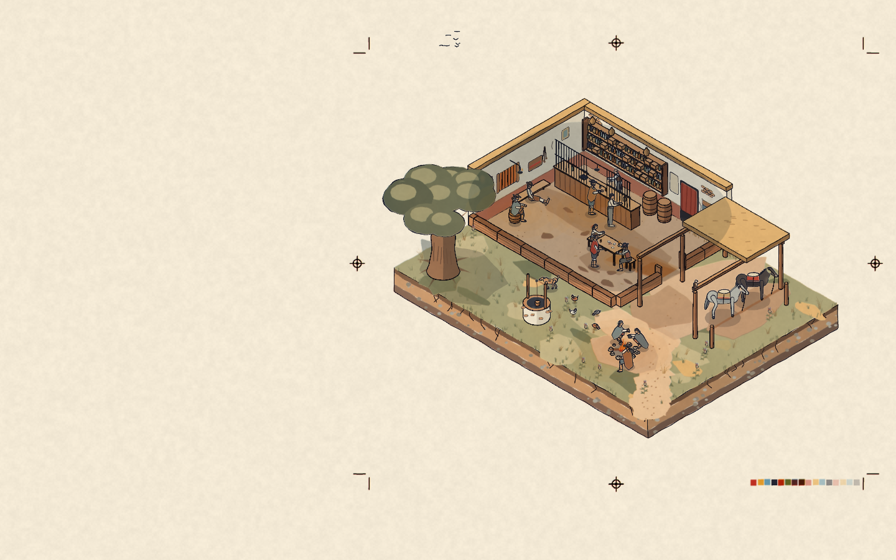
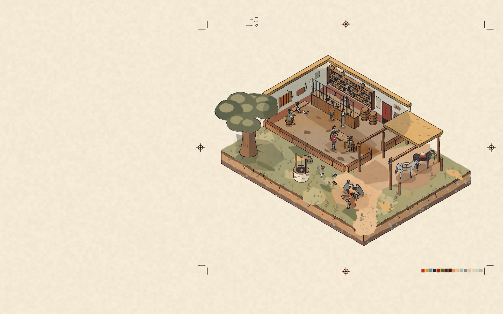
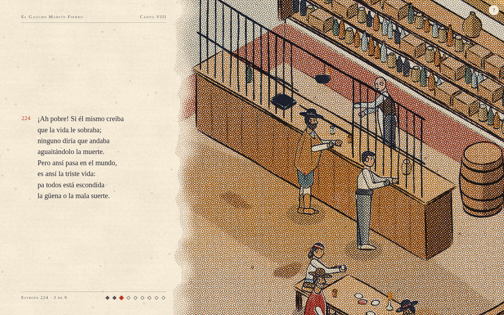
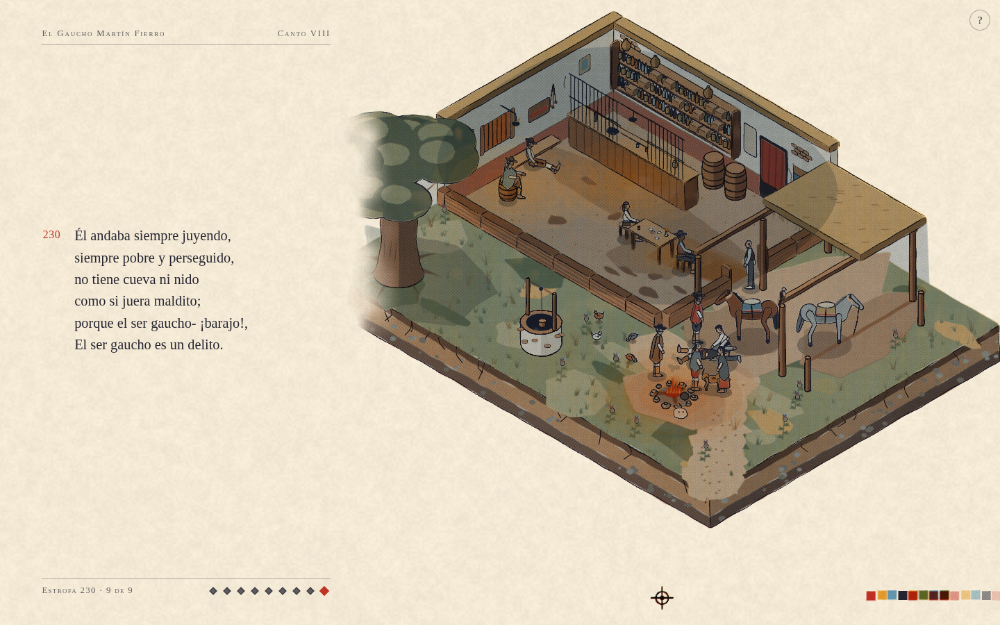
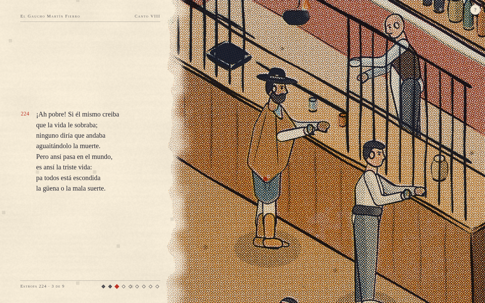

# Comparación visual q0

Capturas reales de Chromium 151, con WebGL2 mediante ANGLE/SwiftShader, a 1440 × 900 píxeles CSS y DPR 1. Ambos rasterizadores usan calidad q0, la misma semilla aleatoria (8128), el mismo encuadre y el mismo estado de los actores después de dos segundos de simulación fija. El script verifica esa igualdad antes de guardar el informe.

Para mostrar la escena de la portada se imprime la lámina inmediatamente y se oculta la tapa durante la captura. Las estrofas conservan su texto y sus márgenes. El detalle adicional duplica el zoom de la estrofa 224.

| Encuadre | Canvas 2D | WebGL2 |
| --- | --- | --- |
| Portada impresa |  |  |
| Estrofa 224 |  |  |
| Estrofa 230 |  |  |
| Detalle 224 |  |  |

Se compararon también las cinco separaciones reales leyendo las dos texturas antes del shader de risografía. [comparacion.json](comparacion.json) contiene diferencias RGB y de cada tinta, más coincidencia de cobertura con una tolerancia de dos píxeles. La diferencia RGB absoluta media es de 0,19 a 0,49 sobre 255; la cobertura de líneas coincide en más del 99,94 % con esa tolerancia. Son métricas descriptivas de estas capturas, no una garantía de igualdad píxel a píxel.

[verificacion.json](verificacion.json) registra los estados, el navegador, WebGL2, errores, operaciones, muestras MSAA y llamadas de dibujo. Incluye una apertura de `?debug` y una pasada manual corta de benchmark para cada rasterizador: se verificaron sus etiquetas, metadatos y la espera de la impresión. SwiftShader no ofrece aquí consultas de tiempo GPU, por lo que se verificó el fallback por lectura de píxel. No se publican cifras de rendimiento de este rasterizador de software.

Todas las lecturas de `gl.getError()` devolvieron cero. El único error de consola fue la petición inicial a `/favicon.ico`, que respondió 404; no hubo errores JavaScript ni de shaders. WebGL2 usó cuatro muestras MSAA: 473, 503 y 561 llamadas de dibujo para 2017, 1267 y 2037 operaciones en los tres encuadres principales; el detalle usó 397 llamadas para 958 operaciones.

## Reproducción

Las dependencias siguientes son herramientas de verificación externas al proyecto; no se agregaron a sus paquetes ni al bundle.

```sh
npm install --prefix /tmp/trama-browser playwright-core
corepack pnpm --filter @obras/martin-fierro dev --host 0.0.0.0
```

En otra terminal, desde la raíz del repositorio:

```sh
TRAMA_URL=http://localhost:5178/ node docs/raster-comparison/capturar.mjs
python docs/raster-comparison/comparar.py
```

El comparador requiere Pillow y NumPy. `CHROMIUM` y `PLAYWRIGHT_CORE` permiten cambiar las rutas del navegador y de `playwright-core`; `TRAMA_CANALES` permite cambiar el directorio temporal de las lecturas de separaciones. El script resuelve la importación de benchmark desde la ubicación del repositorio para el servidor Vite. Desactiva RAF, IntersectionObserver y HMR sólo en las páginas de captura, fija la semilla antes de importar la escena y conduce el render con `Stage.step`.
